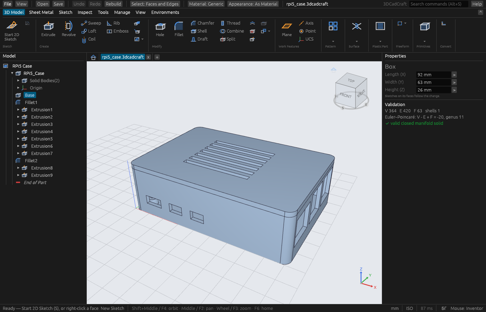
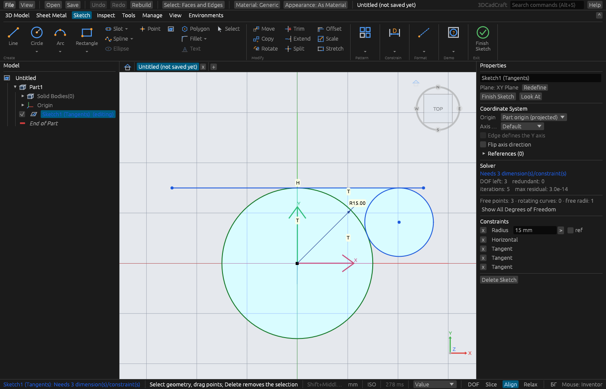
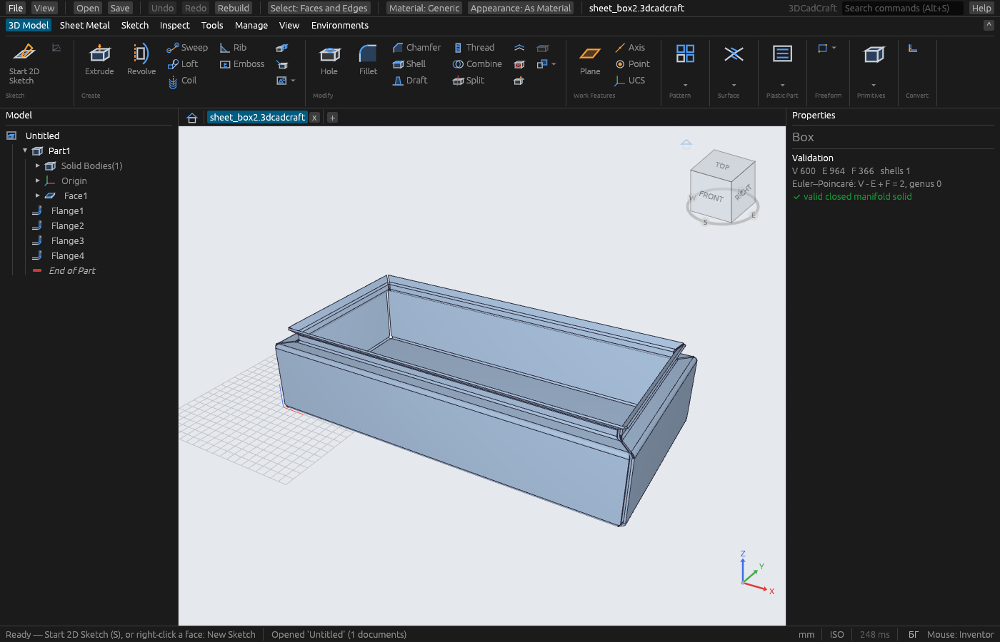
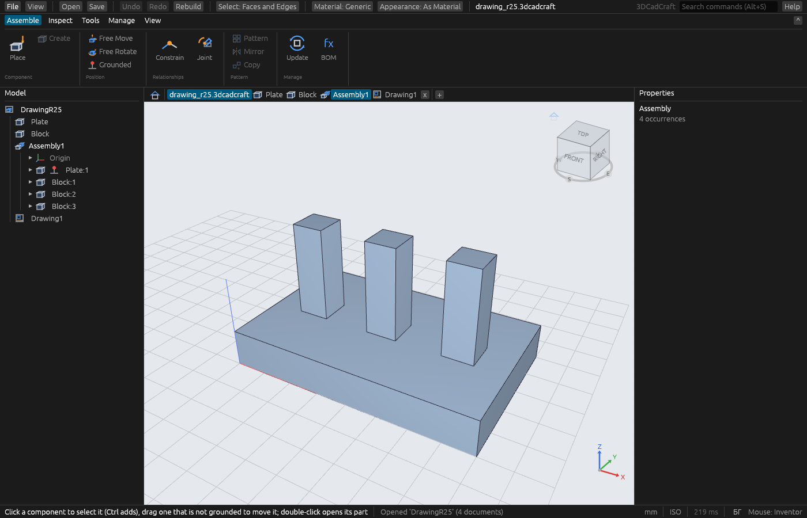
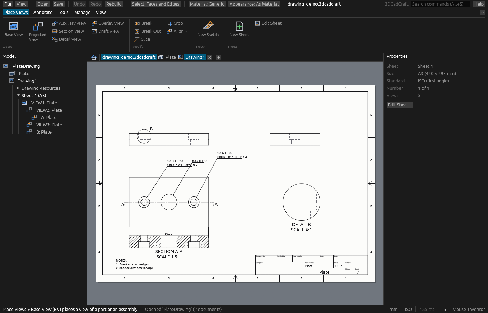
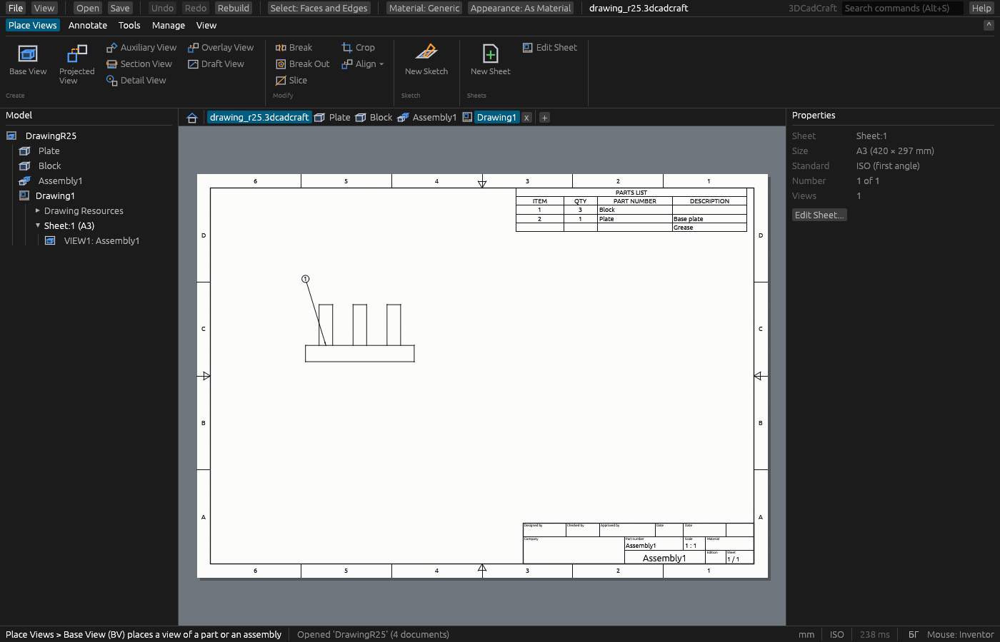

# 3DCadCraft

[](https://github.com/velog/3dCadCraft/actions/workflows/ci.yml)

**Open-source parametric 3D CAD in pure Rust**, with a user interface that
follows Autodesk Inventor, so Inventor users can switch with little
relearning. Parts, sheet metal, assemblies and drawings in one file, a feature
history you can roll back and edit, and (planned) an API so AI agents can
drive it.

> **Status (October 2026): early, actively developed, not released yet.**
> Part modelling, sheet metal, first assemblies and drawings work and are
> tested every day; many features are implemented but still waiting for their
> visual check. Expect rough edges — and please report them.

*Българска версия — по-долу.*



<sub>A Raspberry Pi 5 case (base with four M2.5 standoffs, port openings, a lid
with vent slots and rounded edges), built through the API and opened in the
application: 12 features, 2 bodies, a valid closed solid.</sub>

## Screenshots

| | |
|---|---|
|  |  |
| **Sketch** — constraints, dimensions and the solver's DOF / redundancy report | **Sheet metal** — Face + Flanges with corner reliefs; flat pattern to DXF |
|  |  |
| **Assembly** — placed components, constraints and joints on one solver | **Drawing** — base, projected, section and detail views, hole notes, PDF |



<sub>An assembly view with a parts list computed from the assembly and a balloon
that follows its item number.</sub>

## Real cases

Everything above is a real model, not a mock-up. You can build each one
yourself and open it:

| Case | What it exercises | Build it |
|---|---|---|
| Plate with counterbored holes + drawing | Hole (ISO clearance / counterbore), drawing views, section, detail, hole notes, PDF export | `cargo run --example drawing_demo -- plate.3dcadcraft` |
| Rounded box | fillets with spherical corners, a chamfer around a loop of lines and arcs | `cargo run --example rounded_box -- rounded.3dcadcraft` |
| Hollow box | pocket + rounded inner edges (or chamfers) | `cargo run --example hollow_box -- hollow.3dcadcraft` |
| Vent plate | 40 rectangles cut in one Extrude | `cargo run --example vent_plate -- vent.3dcadcraft` |
| Radial grille | circular sketch pattern, cut every other sector | `cargo run --example grille -- grille.3dcadcraft` |
| Large patterns | 5 041 holes in ~7 s, 10 000 in ~14 s (release) | `cargo run --release --no-default-features --example pattern_probe -- hole 71` |
| Large assembly | thousands of occurrences for speed tests | `cargo run --example big_assembly -- big.3dcadcraft 5000` |

Then `cargo run --release -- plate.3dcadcraft`. A part can be exported to
STEP / STL / GLB (`cargo run --example export -- in.3dcadcraft out.step`) and a
sheet metal flat pattern to DXF (`--example flat_dxf`).

Bugs found in real sessions become regression tests: the user's action journal
(Help → Save Diagnostics) is replayed step by step, e.g. a sweep along a
spline, a loft with a centre line, an M8 modeled thread in a blind hole and a
sheet metal cut across a bend (`tests/data/*_journal.jsonl`).

## Where it is

| Area | State | Notes |
|---|---|---|
| Sketching | ✅ | all Inventor line / circle / arc / rectangle / slot / polygon / spline variants, ~20 constraint and dimension kinds, sparse solver with DOF analysis, Modify tools, patterns, projected geometry |
| Part features | 🟡 | Extrude, Revolve, Hole, Thread, Fillet, Chamfer, Shell, Face Draft, Pattern, Mirror, Sweep, Loft, Coil, Rib, Combine, Split, Thicken / Offset, work features, primitives — done; many waiting for their visual check |
| History and parameters | ✅ | End of Part, reorder, suppress (also by condition), Edit Feature with live preview and drag handles, unit-aware expressions in every numeric field |
| Sheet metal | 🟡 | Face, Flange, Contour Flange, Hem, Fold, Cut, Unfold / Refold, Corner Round / Chamfer, Convert, Flat Pattern, DXF; Bend, Rip, Corner Seam, Punch, Lofted Flange — interface only |
| Assemblies | 🟡 | Place (also linked part files), Ground, Free Move / Rotate, Mate / Flush / Angle / Insert, joints with limits, BOM; patterns, interference, subassemblies — to do |
| Drawings | 🟡 | sheets and title blocks, base / projected / section / detail / auxiliary views with hidden lines, dimensions, hole notes, parts lists, balloons, bend tables, PDF; Break / Crop, DXF — to do |
| Interface | 🟡 | ribbon with the full Inventor command set (unimplemented commands disabled with their spec), ViewCube, visual styles, section views, selection filters, right-click menus by selection, aliases and command search (Alt+S), presets, materials and appearances |
| Files and exchange | 🟡 | one `.3dcadcraft` file with many documents, Link / Append / Pack, autosave and crash recovery; export STEP / STL / GLB / PDF / DXF; **STEP import — to do** |
| API for AI agents | ⬜ | JSON-RPC / MCP server — planned |

Behind it: an exact B-Rep kernel, about 930 automated tests (including
reference cases, file compatibility fixtures and speed budgets) and 58 feature
specifications describing Inventor's behaviour option by option.

## What is left

The full plan is in [docs/ROADMAP.md](docs/ROADMAP.md); the main open items:

1. **Critical fixes first:** slow picking and Slice Graphics on parts with a
   modeled thread, countersinks at other angles than 90°, a slow fillet test
   under load (ROADMAP "⚠ Critical fixes").
2. **Visual check** of everything implemented but not yet confirmed in the
   running app (shell, draft, patterns, materials, assemblies, sheet metal…).
3. **Part commands still without logic:** Delete Face, Move
   Bodies, Copy Object, Emboss, Sketch Driven Pattern, surfaces (Stitch, Sculpt,
   Patch, Trim, Extend), Derive, plastic part, freeform.
4. **Assemblies:** Tangent / Symmetry, Drive and Animate, component patterns,
   interference, subassemblies, Replace, edit in place.
5. **Drawings:** Break / Break Out / Crop views, angular dimensions, DXF export.
6. **Exchange:** STEP import.
7. **Automation:** the command API and the MCP server for AI agents, batch
   processing from the command line.
8. Later: frame generator, standard components, weldments, FEA, rendering.

## Build and run

You need [Rust](https://rustup.rs) (stable). On Windows, also the Visual
Studio C++ build tools (the Rust installer offers them).

```bash
git clone https://github.com/velog/3dCadCraft.git
cd 3dCadCraft
cargo run --release                          # start the application
cargo run --release -- my-part.3dcadcraft    # open a project
cargo test --no-default-features             # tests without the GUI (fast)
cargo xtask ci                               # every check CI runs
```

Use `--release`: geometry is much slower in debug builds. Settings live in
`%APPDATA%\3dcadcraft` (Linux: `~/.config/3dcadcraft`).

Geometry runs on an exact B-Rep kernel ([SolidCraft](https://github.com/bherbruck/solidcraft)
on [truck](https://github.com/ricosjp/truck), MIT/Apache), with a few local
fixes kept in `vendor/`.

## Contributing

Contributions are very welcome — see **[CONTRIBUTING.md](CONTRIBUTING.md)**
and the developer guide **[CLAUDE.md](CLAUDE.md)** (for humans and AI agents
alike). Good places to start: the **⚠ Critical fixes** list at the top of
[docs/ROADMAP.md](docs/ROADMAP.md), and the ⬜ rows in `docs/spec/`.

| Document | |
|---|---|
| [docs/PROJECT.md](docs/PROJECT.md) | vision, principles, architecture |
| [docs/FEATURES.md](docs/FEATURES.md) | every feature by level, with status |
| [docs/spec/](docs/spec/) | per-feature specs: Inventor's behaviour option by option, with our status |
| [docs/UI.md](docs/UI.md), [docs/REFERENCE.md](docs/REFERENCE.md) | interface, mouse, keys, menus |
| [docs/FILE_FORMAT.md](docs/FILE_FORMAT.md) | the `.3dcadcraft` format |
| [docs/ROADMAP.md](docs/ROADMAP.md) | phases and critical issues |
| [docs/PERF.md](docs/PERF.md) | speed targets and measurements |

## Licence

Dual-licensed under **MIT** ([LICENSE-MIT](LICENSE-MIT)) **or Apache-2.0**
([LICENSE-APACHE](LICENSE-APACHE)), at your option. Third-party code is
listed in [ATTRIBUTION.md](ATTRIBUTION.md).

"Inventor" and "Autodesk" are trademarks of Autodesk, Inc. 3DCadCraft is an
independent project, not affiliated with or endorsed by Autodesk. It
reproduces Inventor's *behaviour* for familiarity; it contains no Autodesk
code, text, icons or file formats.

---

## На български

Параметрична 3D CAD система с отворен код, написана изцяло на Rust. Интерфейсът следва Autodesk Inventor за лесна миграция; детайли, ламарина, сглобки и чертежи в един файл; история на операциите с End of Part; API за AI агенти (предстои).

**Докъде е (октомври 2026):** скицирането е завършено; повечето операции за детайли (Extrude, Revolve, Hole, Thread, Fillet, Chamfer, Shell, Draft, масиви, Sweep, Loft, Coil, Rib, Combine, Split) работят; ламарина с разгъвка и DXF; първи сглобки (връзки, шарнири, спецификация); чертежи с изгледи, разрези, детайли, коти, бележки за отвори, таблица на частите, балони и PDF. Много от тях чакат визуална проверка. Снимките по-горе са от реални модели, които всеки може да построи с `cargo run --example …` (вижте таблицата „Real cases“).

**Какво остава:** спешните поправки за бързина (резба, зенкери), визуалната проверка, логиката на останалите команди за детайли (Delete Face, повърхнини, Derive…), сглобки (масиви от компоненти, колизии, подсглобки), чертежи (Break/Crop, DXF), внос на STEP, API/MCP за AI агенти. Пълният план: [docs/ROADMAP.md](docs/ROADMAP.md).

```powershell
git clone https://github.com/velog/3dCadCraft.git 3dCadCraft
cd 3dCadCraft
cargo run --release
```

Нужни са [Git](https://git-scm.com/download/win) и [Rust](https://rustup.rs) (`rustup-init.exe`, с „Desktop development with C++“ от Visual Studio Build Tools, което инсталаторът предлага). Настройките са в `%APPDATA%\3dcadcraft\settings.json`; за визуални тестове под Windows има `tools/gui_win.py`, под Linux — `tools/gui_sim.py`.

Искате да помогнете? Вижте [CONTRIBUTING.md](CONTRIBUTING.md) и списъка „⚠ Critical fixes“ в [docs/ROADMAP.md](docs/ROADMAP.md). При проблем: **Help → Save Diagnostics…** и приложете zip файла към issue.

Лиценз: MIT OR Apache-2.0. „Inventor“ е търговска марка на Autodesk, Inc. 3DCadCraft не е свързан с Autodesk.
