# 3DCadCraft

[](https://github.com/velog/3dCadCraft/actions/workflows/ci.yml)

**Open-source parametric 3D CAD in pure Rust**, with a user interface that
follows Autodesk Inventor, so Inventor users can switch with little
relearning. Parts, sheet metal, assemblies and drawings in one file, a feature
history you can roll back and edit, and (planned) an API so AI agents can
drive it.

> **Status (November 2026): early, actively developed, pre-release.**
> Part modelling, surfaces, sheet metal, plastic parts, assemblies, frames, a
> component library and drawings work and are tested every day; many features
> are implemented but still waiting for their visual check. Expect rough
> edges — and please report them.

*Българска версия — по-долу.*

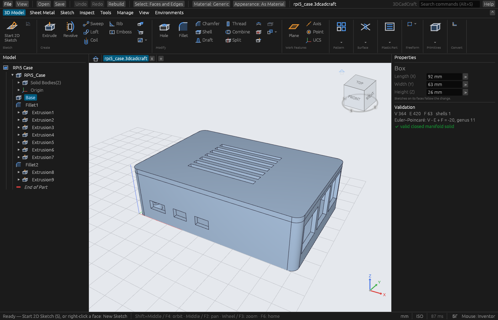

<sub>A Raspberry Pi 5 case (base with four M2.5 standoffs, port openings, a lid
with vent slots and rounded edges), built through the API and opened in the
application: 12 features, 2 bodies, a valid closed solid.</sub>

## Screenshots

| | |
|---|---|
| 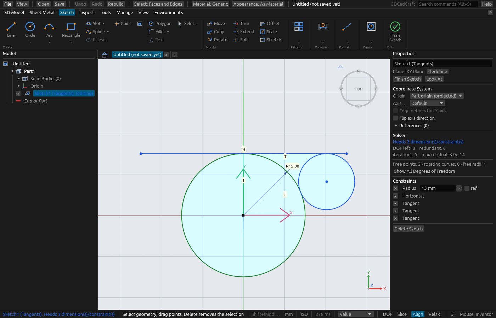 | 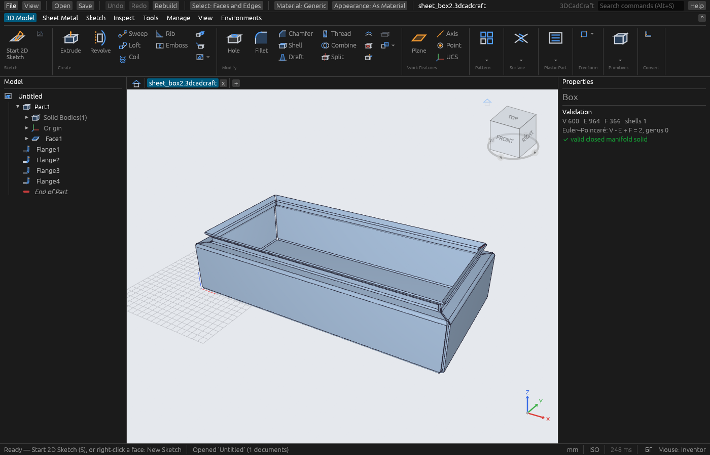 |
| **Sketch** — constraints, dimensions and the solver's DOF / redundancy report | **Sheet metal** — Face + Flanges with corner reliefs; flat pattern to DXF |
| 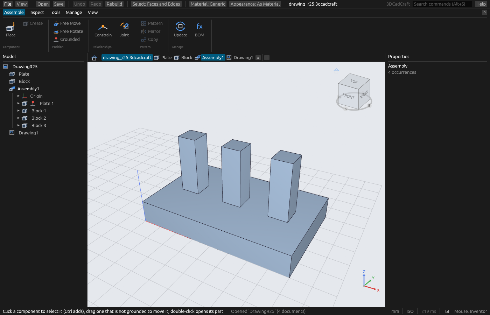 | 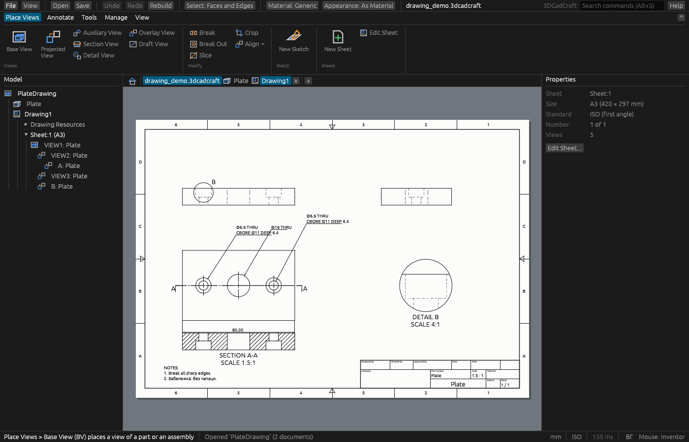 |
| **Assembly** — placed components, constraints and joints on one solver | **Drawing** — base, projected, section and detail views, hole notes, PDF |
| 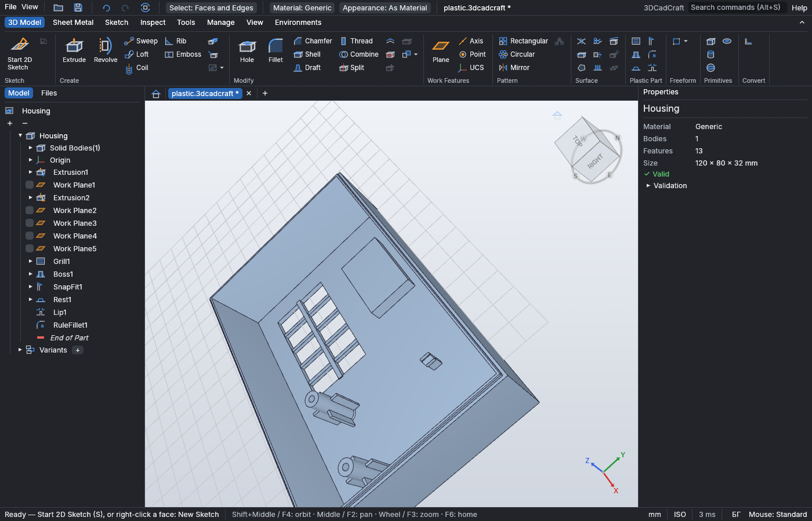 | 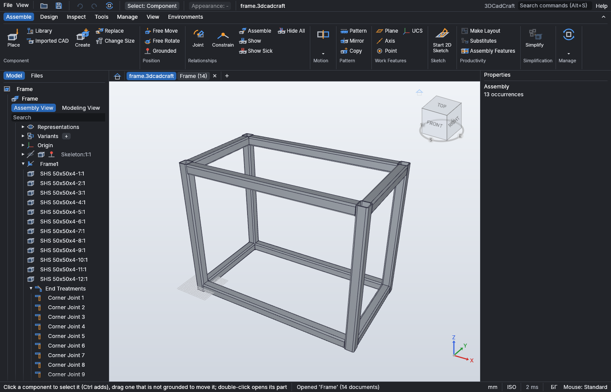 |
| **Plastic parts** — Grill, Boss, Rest, Snap Fit, Rule Fillet and Lip as features | **Frames** — section tables, members along a skeleton, corners, notches |
| 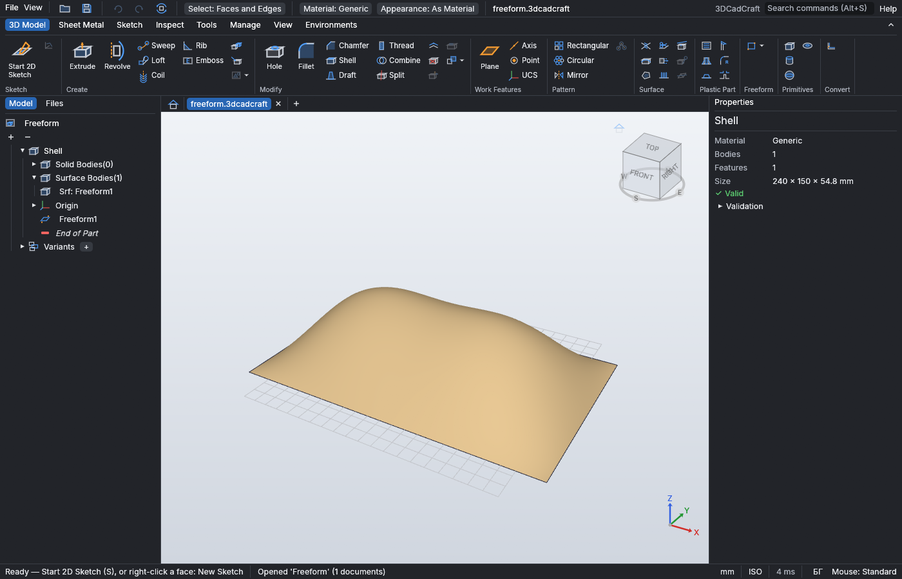 | 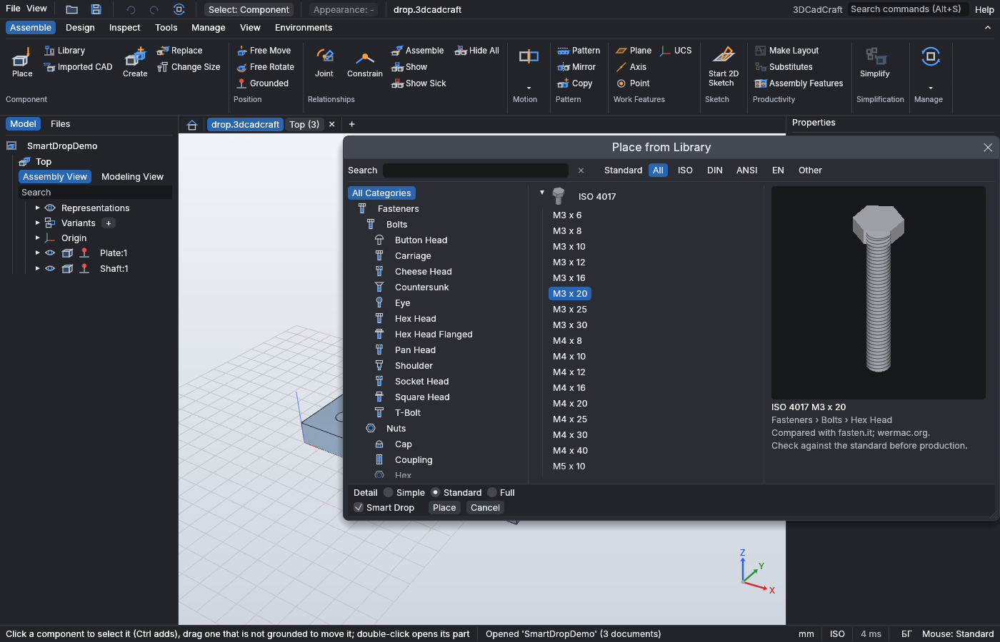 |
| **Surfaces and Freeform** — a control cage shaped point by point; Stitch, Patch, Trim, Sculpt | **Component Library** — 160 families of standard parts, placed with Smart Drop |

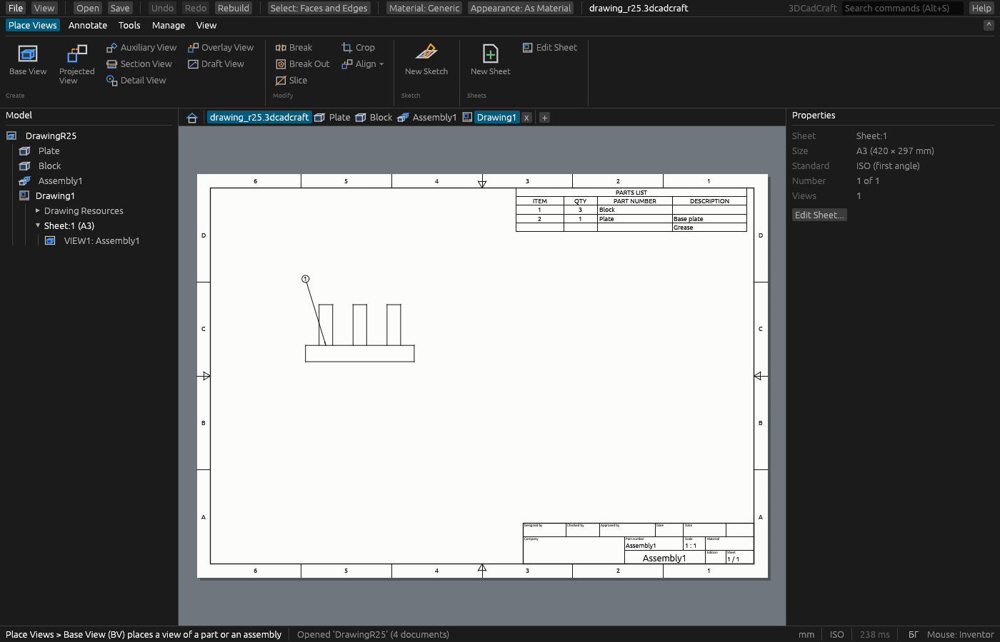

<sub>An assembly view with a parts list computed from the assembly and a balloon
that follows its item number.</sub>

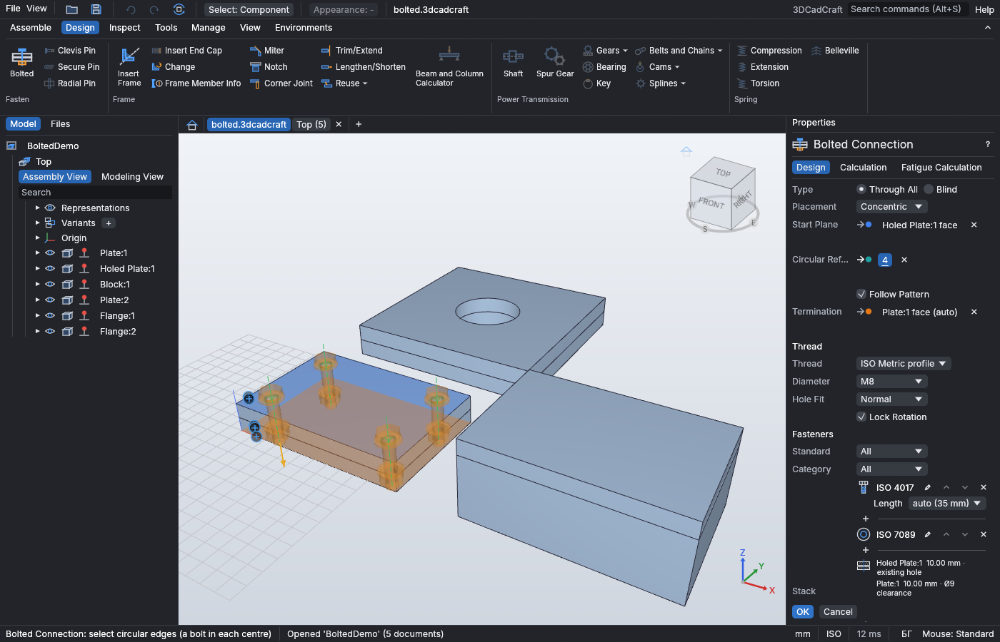

<sub>Bolted Connection: one click on a hole's rim finds the plate stack, the
length of the bolt and the washers; Follow Pattern puts one in every hole.</sub>

## Real cases

Everything above is a real model, not a mock-up. You can build each one
yourself and open it:

| Case | What it exercises | Build it |
|---|---|---|
| Plate with counterbored holes + drawing | Hole (ISO clearance / counterbore), drawing views, section, detail, hole notes, PDF export | `cargo run --example drawing_demo -- plate.3dcadcraft` |
| Rounded box | fillets with spherical corners, a chamfer around a loop of lines and arcs | `cargo run --example rounded_box -- rounded.3dcadcraft` |
| Hollow box | pocket + rounded inner edges (or chamfers) | `cargo run --example hollow_box -- hollow.3dcadcraft` |
| Vent plate | 40 rectangles cut in one Extrude | `cargo run --example vent_plate -- vent.3dcadcraft` |
| Radial grille | circular sketch pattern, cut every other sector | `cargo run --example grille -- grille.3dcadcraft` |
| Large patterns | thousands of holes in one feature | `cargo run --release --no-default-features --example pattern_probe -- hole 71` |
| Large assembly | thousands of occurrences for speed tests | `cargo run --example big_assembly -- big.3dcadcraft 5000` |
| Plastic housing | Grill, Boss, Snap Fit, Rest, Lip, Rule Fillet | `cargo run --example plastic_demo -- plastic.3dcadcraft built` |
| Welded frame | twelve members along a skeleton, corners treated | `cargo run --example frame_demo -- frame.3dcadcraft` |
| Freeform shell | a control cage with moved points | `cargo run --example freeform_demo -- freeform.3dcadcraft` |
| Mechanisms | a delta robot and an arm as flexible subassemblies | `cargo run --example mechanisms_demo -- mech.3dcadcraft` |
| Motion | motion links, a cam and a contact stop | `cargo run --example motion_demo -- motion.3dcadcraft` |
| Bolted Connection | plates and holes ready for the command | `cargo run --example bolted_demo -- bolted.3dcadcraft` |

Then `cargo run --release -- plate.3dcadcraft`. A part can be exported to
STEP / STL / GLB (`cargo run --example export -- in.3dcadcraft out.step`) and a
sheet metal flat pattern to DXF (`--example flat_dxf`).

Bugs found in real sessions become regression tests: the user's action journal
(Help → Save Diagnostics) is replayed step by step, e.g. a sweep along a
spline, a loft with a centre line, an M8 modeled thread in a blind hole and a
sheet metal cut across a bend (`tests/data/*_journal.jsonl`).

## Where it is

| Area | State | Notes |
|---|---|---|
| Sketching | ✅ | all Inventor line / circle / arc / rectangle / slot / polygon / spline variants, ~20 constraint and dimension kinds, sparse solver with DOF analysis, Modify tools, patterns, projected geometry, text with any installed font; 3D sketch — to do |
| Part features | 🟡 | Extrude, Revolve, Hole, Thread, Fillet, Chamfer, Shell, Face Draft, Pattern, Mirror, Sweep, Loft, Coil, Rib, Combine, Split, Thicken / Offset, Delete Face, Move Bodies, Copy Object, Emboss / Engrave, Derive, work features, primitives — done; many waiting for their visual check |
| Surfaces and Freeform | 🟡 | Stitch, Boundary Patch, Trim, Extend, Ruled Surface, Sculpt, Replace Face, Loft between surfaces; Freeform Plane / Cylinder with Edit Form; other Freeform primitives — interface only |
| Plastic parts | 🟡 | Grill, Boss, Rest, Snap Fit, Rule Fillet, Lip, with live preview and editable section pictures |
| History and parameters | ✅ | End of Part, reorder, suppress (also by condition), Edit Feature with live preview and drag handles, unit-aware expressions in every numeric field, linked parameters, part families and variants |
| Sheet metal | 🟡 | Face, Flange (Further Bends, extents), Contour Flange, Contour Roll, Lofted Flange, Hem types, Fold, Bend, Rip, Cut, Unfold / Refold, Corner Round / Chamfer, Convert (also of imported sheets), Flat Pattern, DXF, rules as a spreadsheet; Punch — interface only |
| Assemblies | 🟡 | Place (linked files, STEP), Mate / Flush / Angle / Insert, Assemble, joints with limits, subassemblies (also flexible), patterns, Replace / Copy / Mirror, Interference, Motion and Contact, exploded views, View / Position representations and Variants, BOM, edit in place, cross-part references, adaptivity, Derive, Make Components, assembly features, work features and sketches |
| Frames | 🟡 | Insert Frame (EN and ANSI section tables, own profiles), Miter, Corner Joint, Trim / Extend, Lengthen / Shorten, Notch, Change, Edit Frame; End Cap, Reuse — interface only |
| Component Library | 🟡 | 160 families with levels of detail, published part families, Smart Drop, Change Size, connections, Bolted Connection (through holes, blind, circular and linear layouts, follows the plates); the other Design Accelerator calculators — interface only |
| Drawings | 🟡 | sheets, borders, title blocks and sketched symbols you define, base / projected / section (offset, aligned) / detail / auxiliary / break / break out / draft views, sheet and view sketches, dimensions (baseline, chain, ordinate, angular), hole, chamfer and bend notes, parts lists, balloons, hole, bend, revision and general tables, layers, PDF; Overlay, Slice, Crop, weld and GD&T symbols, DXF — to do |
| Interface | 🟡 | Home page, ribbon with the full Inventor command set (commands without logic have a grey icon and their full panel), View Cube, visual styles, section views, dark and light themes with colour schemes, selection filters, right-click menus by selection, Next / Back in every command, the value next to the cursor, aliases, command search (Alt+S), your own keys and the import of Inventor's, presets, materials and appearances, progress for long operations |
| Files and exchange | 🟡 | a `.3dcadcraft` design file or one file per document (`.ccpart` / `.ccasm` / `.ccdrw`), design projects and templates, Link / Append / Pack and Go, autosave and crash recovery; **import** STEP (parts and assemblies, Reference Model with Update), STL, OBJ; export STEP / STL / GLB / PDF / DXF / SVG; IGES and others — to do |
| API for AI agents | ⬜ | JSON-RPC / MCP server — planned |

Behind it: an exact B-Rep kernel, about 1 800 automated tests (including
reference cases, file compatibility fixtures and speed budgets) and more than
85 feature specifications describing Inventor's behaviour option by option.

## Being worked on now

In progress on development branches on 9 November 2026, before it reaches `main`:

- **Drawings:** more dimension types; title blocks and borders checked in the app.
- **Frames:** a frame as a subassembly of its own (Inventor's model), Create New Frame.
- **Long operations:** OK and Rebuild All on a worker thread, so the window
  stays responsive; OK takes the part its preview has already built.
- **Assemblies:** edges and vertices of components as inputs of work features,
  a picture column in the BOM.
- **Hard surface cases:** symmetric Thicken of an egg, Split Face of a guided
  patch, rounded Shell corners on drafted walls, the chamfer of an inclined hole's exit.
- **Drawing views:** a rim seen almost end-on is not hidden by its own wall.
- **Speed of the new kernel:** one Extrude of a plate with 5 041 holes takes
  about 32 s today, and we keep working on it.

## What is left

The full plan is in [docs/ROADMAP.md](docs/ROADMAP.md); the main open items:

1. **Visual check** of everything implemented but not yet confirmed in the
   running app.
2. **Speed:** many-hole parts, long operations off the main thread, modeled
   threads and countersinks (ROADMAP "⚠ Critical fixes").
3. **Modelling:** 3D sketch, Sketch Driven Pattern, Bend Part, Decal, direct
   editing, the other Freeform primitives, surface analyses, feature templates.
4. **Assemblies:** simplification, Make Layout, the Design Accelerator
   calculators (shafts, gears, bearings, springs…).
5. **Drawings:** Overlay / Slice / Crop views, weld and GD&T symbols, automated
   centrelines, DXF export.
6. **Exchange:** IGES and other formats.
7. **Automation:** the command API and the MCP server for AI agents, batch
   processing from the command line.
8. Later: weldments, tube and pipe, FEA, rendering.

## Download

Ready-made builds for **Windows** (`.zip`) and **Linux** (`.tar.gz`, x86-64) are on the
[Releases](https://github.com/velog/3dCadCraft/releases) page: unpack and run `3dcadcraft`
(`3dcadcraft.exe`). They are pre-releases — keep copies of your projects.

## Build and run

You need [Rust](https://rustup.rs) (stable). On Windows, also the Visual
Studio C++ build tools (the Rust installer offers them).

```bash
git clone https://github.com/velog/3dCadCraft.git
cd 3dCadCraft
cargo run --release                          # start the application
cargo run --release -- my-part.3dcadcraft    # open a project
cargo test --no-default-features             # tests without the GUI (fast)
cargo xtask ci                               # every check CI runs
```

Use `--release`: geometry is much slower in debug builds. Settings live in
`%APPDATA%\3dcadcraft` (Linux: `~/.config/3dcadcraft`).

Geometry runs on an exact B-Rep kernel: [SolidCraft](https://github.com/tangency-labs/solidcraft)
(MIT/Apache) on [solidcore](https://github.com/tangency-labs/solidcore) (Apache-2.0), with
our fixes kept in `vendor/` and in [a fork of solidcore](https://github.com/velog/solidcore).

## Contributing

Contributions are very welcome — see **[CONTRIBUTING.md](CONTRIBUTING.md)**
and the developer guide **[CLAUDE.md](CLAUDE.md)** (for humans and AI agents
alike). Good places to start: the **⚠ Critical fixes** list at the top of
[docs/ROADMAP.md](docs/ROADMAP.md), and the ⬜ rows in `docs/spec/`.

| Document | |
|---|---|
| [docs/PROJECT.md](docs/PROJECT.md) | vision, principles, architecture |
| [docs/FEATURES.md](docs/FEATURES.md) | every feature by level, with status |
| [docs/spec/](docs/spec/) | per-feature specs: Inventor's behaviour option by option, with our status |
| [docs/UI.md](docs/UI.md), [docs/REFERENCE.md](docs/REFERENCE.md) | interface, mouse, keys, menus |
| [docs/FILE_FORMAT.md](docs/FILE_FORMAT.md) | the `.3dcadcraft` format |
| [docs/ROADMAP.md](docs/ROADMAP.md) | phases and critical issues |
| [docs/PERF.md](docs/PERF.md) | speed targets and measurements |

## Licence

Dual-licensed under **MIT** ([LICENSE-MIT](LICENSE-MIT)) **or Apache-2.0**
([LICENSE-APACHE](LICENSE-APACHE)), at your option. Third-party code is
listed in [ATTRIBUTION.md](ATTRIBUTION.md).

"Inventor" and "Autodesk" are trademarks of Autodesk, Inc. 3DCadCraft is an
independent project, not affiliated with or endorsed by Autodesk. It
reproduces Inventor's *behaviour* for familiarity; it contains no Autodesk
code, text, icons or file formats.

---

## На български

Параметрична 3D CAD система с отворен код, написана изцяло на Rust. Интерфейсът следва Autodesk Inventor за лесна миграция; детайли, повърхнини, ламарина, пластмасови детайли, сглобки, рамки, библиотека от стандартни части и чертежи; история на операциите с End of Part; API за AI агенти (предстои).

**Докъде е (ноември 2026):** скицирането е завършено, включително текст с всеки инсталиран шрифт. Работят повечето операции за детайли, повърхнините (Stitch, Patch, Trim, Sculpt, Freeform) и пластмасовите детайли (Grill, Boss, Rest, Snap Fit, Rule Fillet, Lip). Ламарината е с разгъвка и DXF, а сглобките — с подсглобки, масиви, колизии, движение и контакт, Variants, редакция на място и адаптивност. Има рамки (Frame Generator), библиотека от 160 фамилии стандартни части със Smart Drop, Bolted Connection, внос на STEP / STL / OBJ и Pack and Go. Чертежите са с разрези, Break и Break Out, скици, собствени рамки и антетки, таблици и PDF. Много от тях чакат визуална проверка. Снимките по-горе са от реални модели, които всеки може да построи с `cargo run --example …` (вижте таблицата „Real cases“).

**В процес на работа (9 ноември 2026):** нови видове коти в чертежите; рамката като отделна подсглобка; OK и Rebuild All във фонов режим, за да не спира прозорецът; ръбове и върхове на компоненти като вход за работни равнини и оси; колона със снимка в спецификацията; трудни случаи с повърхнини; бързина на новото ядро при хиляди отвори.

**Какво остава:** визуалната проверка, 3D скица, Sketch Driven Pattern, Decal, директна редакция, останалите Freeform примитиви, анализи на повърхнини, калкулаторите на Design Accelerator, Overlay / Slice / Crop и символи за заварки и GD&T в чертежите, DXF на чертежи, IGES, API/MCP за AI агенти. Пълният план: [docs/ROADMAP.md](docs/ROADMAP.md).

Готови версии за Windows и Linux: [Releases](https://github.com/velog/3dCadCraft/releases). Или от изходния код:

```powershell
git clone https://github.com/velog/3dCadCraft.git 3dCadCraft
cd 3dCadCraft
cargo run --release
```

Нужни са [Git](https://git-scm.com/download/win) и [Rust](https://rustup.rs) (`rustup-init.exe`, с „Desktop development with C++“ от Visual Studio Build Tools, което инсталаторът предлага). Настройките са в `%APPDATA%\3dcadcraft\settings.json`; за визуални тестове под Windows има `tools/gui_win.py`, под Linux — `tools/gui_sim.py`.

Искате да помогнете? Вижте [CONTRIBUTING.md](CONTRIBUTING.md) и списъка „⚠ Critical fixes“ в [docs/ROADMAP.md](docs/ROADMAP.md). При проблем: **Help → Save Diagnostics…** и приложете zip файла към issue.

Лиценз: MIT OR Apache-2.0. „Inventor“ е търговска марка на Autodesk, Inc. 3DCadCraft не е свързан с Autodesk.
